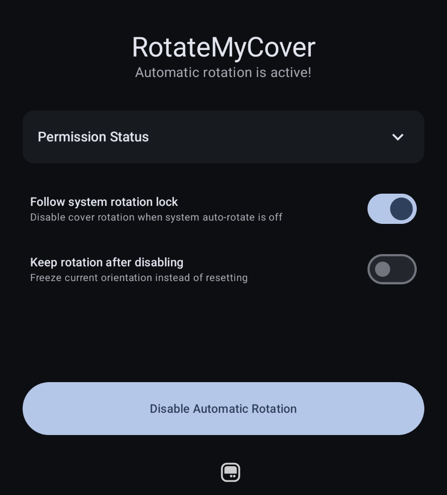
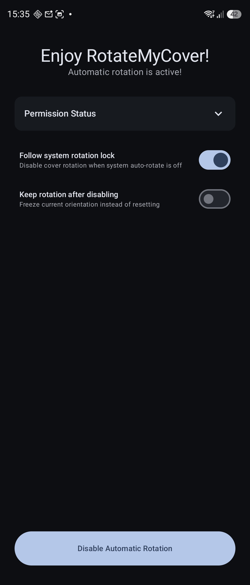

# RotateMyCover

Automatically rotate your foldable device's cover screen to match your phone's orientation.

## Features

- Enable/Disable automatic rotation of your cover screen
- Match your phone's auto rotation settings
- Allow locking the cover screen in a specific orientation

## Screenshots

 

## Supported Devices

This app is only tested on my Samsung Galaxy Z Flip 7, it should also work on other Z Flip devices with the cover screen. Other foldable devices are not tested and may not work.

## Privacy

RotateMyCover does not collect any data. It requires some permissions to work:

- **Accessibility**: Used only to keep the rotation overlay/service active. It does not read screen contents, which the app's permissions actively prevent.

- **Display over other apps**: Used only to create an invisible window on the cover display to request sensor-based orientation.

## AI disclosure

This application was developed with heavy help from AI. The code is still up to my standards and has been checked and verified.

## Installation

RotateMyCover is available on BluApps. [Download it here](https://apps.bludood.com).

You can also download the latest APK from the [Releases page](https://github.com/BluDood/RotateMyCover/releases).
